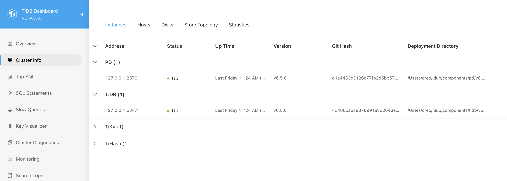
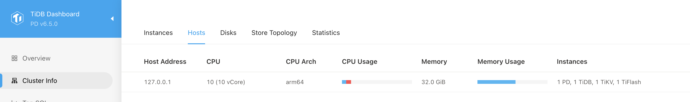
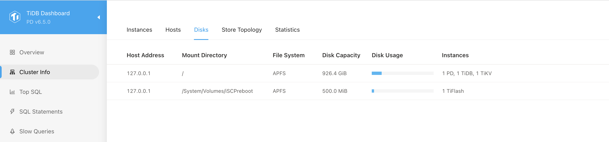

# TiDB Dashboardのクラスター情報ページ {#tidb-dashboard-cluster-information-page}

クラスター情報ページでは、クラスター全体の TiDB、TiKV、PD、 TiFlashコンポーネントの実行状態と、これらのコンポーネントが配置されているホストの実行状態を表示できます。

## ページにアクセスする {#access-the-page}

クラスター情報ページにアクセスするには、次の2つの方法のいずれかを使用できます。

- TiDB Dashboardにログインしたら、左側のナビゲーションメニューで**Cluster Info**をクリックします。

- ブラウザーで[http://127.0.0.1:2379/dashboard/#/cluster_info/instance](http://127.0.0.1:2379/dashboard/#/cluster_info/instance)にアクセスしてください。`127.0.0.1:2379`を実際のPDインスタンスのアドレスとポートに置き換えてください。

## インスタンスリスト {#instance-list}

インスタンスのリストを表示するには、 **Instances**をクリックします。

このインスタンスリストには、クラスター内の TiDB、TiKV、PD、およびTiFlashコンポーネントのすべてのインスタンスの概要情報が表示されます。

リストには次の情報が含まれます。

- Address: インスタンスアドレス。
- Status: インスタンスの実行ステータス。
- Up Time: インスタンスの開始時刻。
- Version: インスタンスのバージョン番号。
- Git Hash: インスタンスバイナリファイルに対応する Git ハッシュ値。
- Deployment directory: インスタンスバイナリファイルが配置されているディレクトリ。

### インスタンスのステータス {#instance-status}

インスタンスは次のいずれかのステータスで実行できます。

- `Up`: インスタンスは正常に実行されています。
- `Down` または`Unreachable`: インスタンスが実行されていないか、対応するホストにネットワークの問題が発生しています。
- `Tombstone`: インスタンス上のデータが完全に移行され、スケールインが完了しました。このステータスは、TiKV またはTiFlashインスタンスにのみ存在します。
- `Leaving`: インスタンス上のデータが移行中で、スケールインが進行中です。このステータスは、TiKV またはTiFlashインスタンスでのみ表示されます。
- `Unknown`: インスタンスの実行状態は不明です。

> **Note:**
>
> - TiDB Dashboardの`Leaving` 、PD API によって返される`Offline` 、およびTiUPの`Pending Offline`は同じステータスを示します。
> - テーブル内の一部の列は、インスタンスが起動している場合にのみ表示できます。

インスタンスのステータスはPDのスケジュール情報から取得されます。詳細については[情報収集](/tidb-scheduling.md#information-collection)を参照してください。

## ホストリスト {#host-list}

ホストのリストを表示するには、 **Hosts**をクリックします。

このホストリストには、クラスター内の TiDB、TiKV、PD、およびTiFlashコンポーネントのすべてのインスタンスに対応するホストの実行ステータスが表示されます。

リストには次の情報が含まれます。

- Host Address: ホスト IP アドレス。
- CPU: ホスト CPU の論理コアの数。
- CPU Usage: 現在の 1秒間のユーザーモードとカーネルモードの CPU 使用率。
- Memory: ホストの合計物理メモリサイズ。
- Memory Usage: ホストの現在のメモリ使用量。

> **Note:**
>
> ホストリスト情報は各インスタンスプロセスによって提供されるため、ホスト上のすべてのインスタンスがダウンしている場合は、ホスト情報は表示されません。

## ディスクリスト {#disk-list}

ディスクのリストを表示するには、 **Disks**をクリックします。

このディスクリストには、TiDB、TiKV、PD、およびTiFlashインスタンスが実行されているディスクのステータスが表示されます。

リストには次の情報が含まれます。

- Host Address: ホスト IP アドレス。
- Mount Directory: インスタンスが実行されているホスト上のこのディスクのマウントパス。
- File System: インスタンスが実行されているホスト上のこのディスクのファイルシステムタイプ。
- Disk Capacity: インスタンスが実行されているホスト上のディスクの合計容量。
- Disk Usage: インスタンスが実行されているホスト上のディスクのスペース使用量。
- Instance: このホスト上で実行されているインスタンス。

> **Note:**
>
> コンポーネントの種類、パーティション構成、およびデプロイメント方法によっては、一部のホストのディスク情報が**Disks**リストに表示されない場合があります。その場合、黄色の警告アイコン（⚠️）が表示されます。アイコンにマウスポインターを合わせると、"Failed to get host information"というツールヒントが表示されます。これは想定内の動作です。
