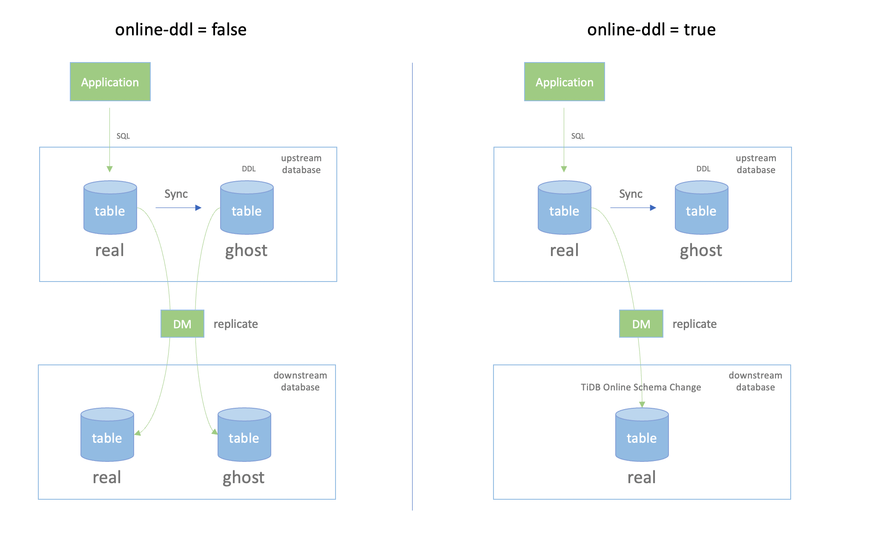

# Continuous Replication from Databases that Use gh-ost or pt-osc

In production scenarios, table locking during DDL execution can block the reads from or writes to the database to a certain extent. Therefore, online DDL tools are often used to execute DDLs to minimize the impact on reads and writes. Common DDL tools are [gh-ost](https://github.com/github/gh-ost) and [pt-osc](https://www.percona.com/doc/percona-toolkit/3.0/pt-online-schema-change.html).

When using DM to migrate data from MySQL to TiDB, you can enable `online-ddl` to allow collaboration of DM and gh-ost or pt-osc.

For the detailed replication instructions, refer to the following documents by scenarios:

- [Migrate Small Datasets from MySQL to TiDB](/migrate-small-mysql-to-tidb.md)
- [Migrate Large Datasets from MySQL to TiDB](/migrate-large-mysql-to-tidb.md)
- [Migrate and Merge MySQL Shards of Small Datasets to TiDB](/migrate-small-mysql-shards-to-tidb.md)
- [Migrate and Merge MySQL Shards of Large Datasets to TiDB](/migrate-large-mysql-shards-to-tidb.md)

## Enable online-ddl on DM

In the task configuration file of DM, set the global parameter `online-ddl` to `true`, as shown below:

```yaml
# ----------- Global configuration -----------
## ********* Basic configuration *********
name: test                      # The name of the task. Should be globally unique.
task-mode: all                  # The task mode. Can be set to `full`, `incremental`, or `all`.
shard-mode: ""                  # Optional. The default value is "", which disables shard DDL merge. For shard merge tasks, set this parameter to "pessimistic". You can also use "optimistic" after understanding its principles and restrictions.
meta-schema: "dm_meta"          # The downstream database that stores the `meta` information.
online-ddl: true                # Enable online-ddl support on DM to support automatic processing of "gh-ost" and "pt-osc" for the upstream database.
```

## Workflow after enabling online-ddl

After online-ddl is enabled on DM, the DDL statements generated by DM replicating gh-ost or pt-osc will change.

The workflow of gh-ost or pt-osc:

- Create a ghost table according to the table schema of the DDL real table.

- Apply DDLs on the ghost table.

- Replicate the data of the DDL real table to the ghost table.

- After the data are consistent between the two tables, use the rename statement to replace the real table with the ghost table.

The workflow of DM:

- Skip creating the ghost table downstream.

- Record DDLs applied to the ghost table.

- Replicate DML changes from the real table, and skip DML statements on the ghost table.

- When the ghost table is renamed to replace the real table upstream, apply the recorded DDLs to the real table downstream.



The change in the workflow brings the following advantages:

- The downstream TiDB does not need to create and replicate the ghost table, saving the storage space and network transmission overhead.

- When you migrate and merge data from sharded tables, the RENAME operation is ignored for each sharded ghost table to ensure the correctness of the replication.

## See also

[Working details for DM with online DDL tools](/dm/feature-online-ddl.md#working-details-for-dm-with-online-ddl-tools)
