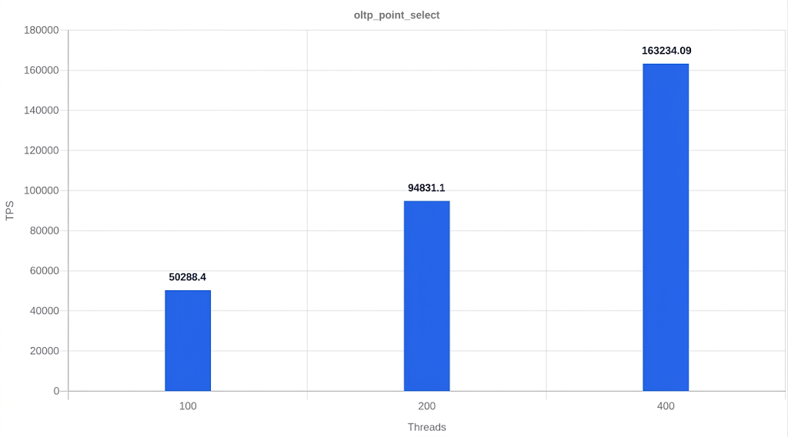
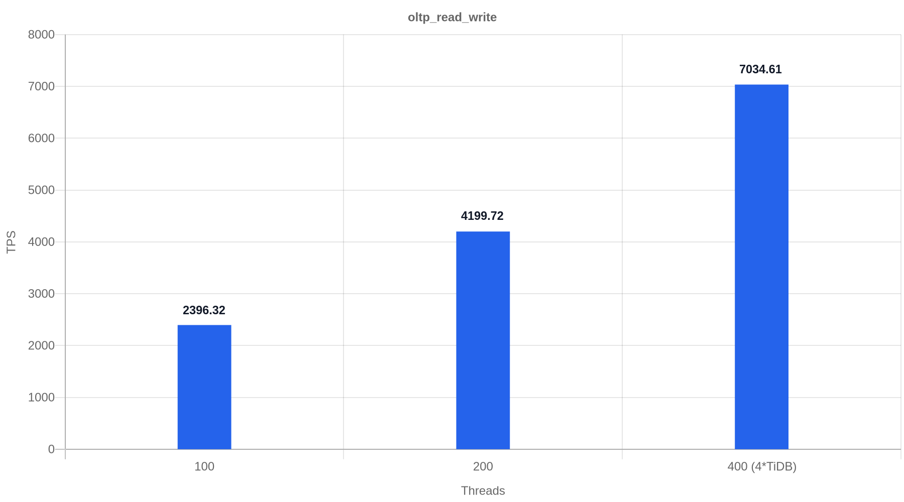
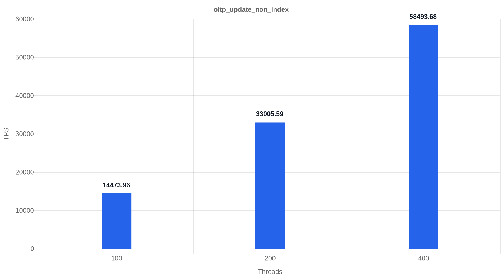
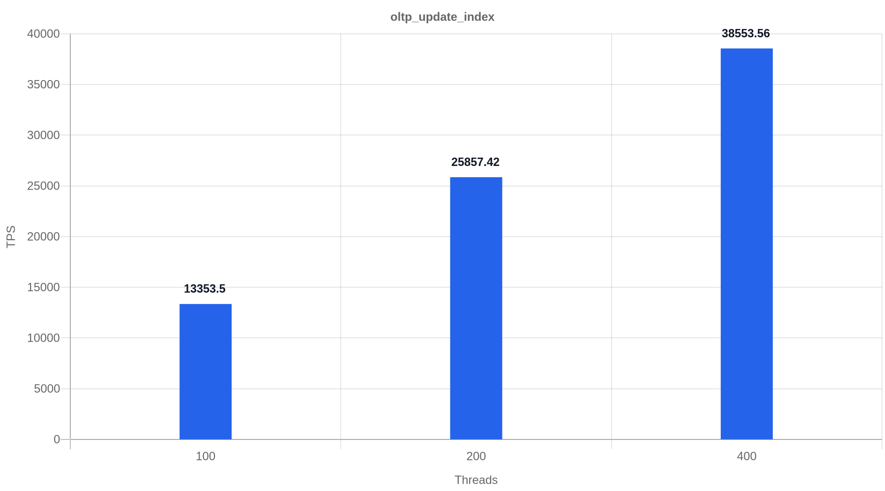
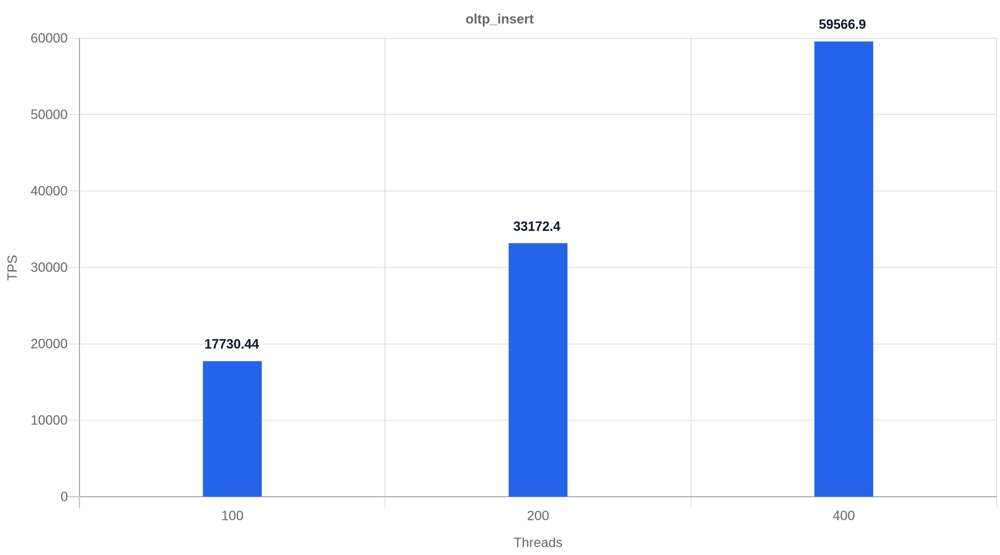

# TiDB Cloud Premium Sysbench Performance Report v26.3.99

This document provides the Sysbench performance test steps and results for TiDB Cloud Premium v26.3.99.

## Test overview

These tests demonstrate the Sysbench performance of TiDB Cloud Premium v26.3.99 in online transaction processing (OLTP) scenarios.

## Test environment

### TiDB cluster

The tests were conducted on a TiDB Cloud Premium cluster with the following settings:

- Cluster version: v26.3.99
- Cloud provider and region: AWS (us-west-2)
- Instance platform: AWS Graviton4
- Request Capacity Units (RCUs): 500,000
- Cluster configuration:

    | Node type | Node size | Instance family | Node quantity | Node storage |
    | --- | --- | --- | --- | --- |
    | TiDB | 16 vCPU, 32 GB | m8g | 2 | N/A |
    | TiKV | 16 vCPU, 64 GB | m8g | 3 | 500 GB |
    | PD | 4 vCPU, 8 GB | c8g | 3 | N/A |

For the `oltp_read_write` test at 400 threads, the cluster used four TiDB nodes. All other tests used two TiDB nodes.

### Parameter configuration

For each workload, the system variable [`tidb_session_plan_cache_size`](/system-variables.md#tidb_session_plan_cache_size-new-in-v710) was set to `1000`:

```sql
SET GLOBAL tidb_session_plan_cache_size = 1000;
```

For the `oltp_insert` and `oltp_read_write` workloads, `tidb_txn_mode` was set to `optimistic`:

```sql
SET GLOBAL tidb_txn_mode = 'optimistic';
```

For the `oltp_update_non_index` and `oltp_update_index` workloads, the TiDB parameter `pessimistic-auto-commit` was disabled:

```toml
[pessimistic-txn]
pessimistic-auto-commit = false
```

### Benchmark executor

The benchmark executor sends SQL queries to the TiDB cluster. The executor used in these tests was a single machine with 12 vCPUs and 24 GB of memory.

## Test steps

The tests used [sysbench](https://github.com/akopytov/sysbench) with 32 tables and 10,000,000 rows per table.

1. In the [TiDB Cloud console](https://tidbcloud.com/), create a TiDB Cloud Premium cluster that meets the [test environment](#test-environment) requirements.
2. Use BR to restore the test data to the `test` database, and wait until the Regions are healthy.
3. Run `ANALYZE TABLE` to collect statistics for the test tables, and warm up the cluster.
4. Run the following command for each workload: `oltp_point_select`, `oltp_read_write`, `oltp_update_non_index`, `oltp_update_index`, and `oltp_insert`. Replace `${WORKLOAD}`, `${HOST}`, `${PORT}`, and `${PASSWORD}` with your actual values. For each workload, set `${THREAD}` to `100`, `200`, and `400` in separate tests. Each test at a given concurrency level lasts 20 minutes.

    ```shell
    sysbench ${WORKLOAD} run \
      --mysql-host=${HOST} \
      --mysql-port=${PORT} \
      --mysql-user=root \
      --db-driver=mysql \
      --mysql-db=test \
      --threads=${THREAD} \
      --time=1200 \
      --report-interval=10 \
      --tables=32 \
      --table-size=10000000 \
      --mysql-ignore-errors=1062,2013,8028,9007 \
      --auto-inc=false \
      --mysql-password=${PASSWORD}
    ```

## Test results

TPS means transactions per second. P95 is the client-side 95th-percentile latency in milliseconds.

### Point select performance

Performance of the `oltp_point_select` workload is shown below:

| Threads | TPS | P95 latency (ms) |
| --- | --- | --- |
| 100 | 50,288.40 | 2.71 |
| 200 | 94,831.10 | 2.86 |
| 400 | 163,234.09 | 3.82 |



### Read write performance

Performance of the `oltp_read_write` workload is shown below:

For the 400-thread test, the cluster was scaled out to four TiDB nodes because the workload saturated the resources of two TiDB nodes.

| Threads | TPS | P95 latency (ms) |
| --- | --- | --- |
| 100 | 2,396.32 | 51.94 |
| 200 | 4,199.72 | 61.08 |
| 400 (4 TiDB nodes) | 7,034.61 | 71.83 |



### Update non-index performance

Performance of the `oltp_update_non_index` workload is shown below:

| Threads | TPS | P95 latency (ms) |
| --- | --- | --- |
| 100 | 14,473.96 | 9.56 |
| 200 | 33,005.59 | 7.30 |
| 400 | 58,493.68 | 8.28 |



### Update index performance

Performance of the `oltp_update_index` workload is shown below:

| Threads | TPS | P95 latency (ms) |
| --- | --- | --- |
| 100 | 13,353.50 | 10.65 |
| 200 | 25,857.42 | 9.06 |
| 400 | 38,553.56 | 13.70 |



### Insert performance

Performance of the `oltp_insert` workload is shown below:

| Threads | TPS | P95 latency (ms) |
| --- | --- | --- |
| 100 | 17,730.44 | 6.67 |
| 200 | 33,172.40 | 7.04 |
| 400 | 59,566.90 | 7.98 |


