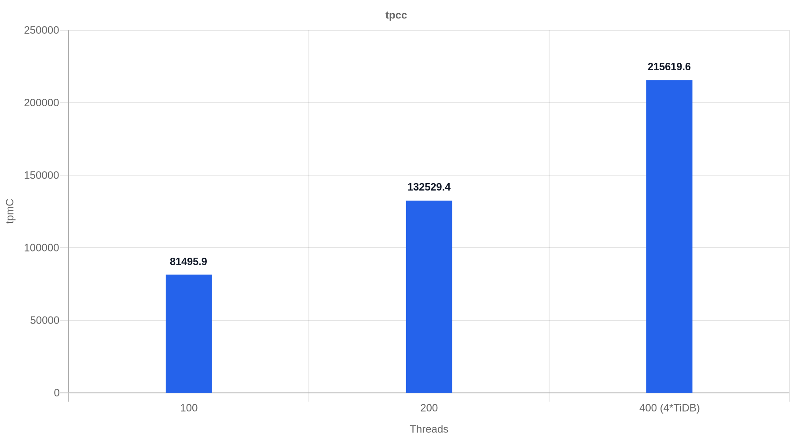

# TiDB Cloud Premium TPC-C Performance Report v26.3.99

This document provides the TPC-C performance test steps and results for TiDB Cloud Premium v26.3.99.

## Test overview

These tests demonstrate the TPC-C performance of TiDB Cloud Premium v26.3.99 in online transaction processing (OLTP) scenarios.

## Test environment

### TiDB cluster

The tests were conducted on a TiDB Cloud Premium cluster with the following settings:

- Cluster version: TiDB-X-CLOUD.202603.1
- Cloud provider and region: AWS (us-west-2)
- initialRCU/Maximum RCU : 500000
- Cluster configuration:

    | Node type | Node size | Instance family | Node quantity | Node storage |
    | --- | --- | --- | --- | --- |
    | TiDB | 16 vCPU, 32 GB | m8g | 2 | N/A |
    | TiKV | 16 vCPU, 64 GB | m8g | 3 | 500 GB |
    | PD | 4 vCPU, 8 GB | c8g | 3 | N/A |

For the 400-thread test, the cluster used four TiDB nodes. The 100-thread and 200-thread tests used two TiDB nodes.

### Parameter configuration

For each workload, the system variable [`tidb_session_plan_cache_size`](/system-variables.md#tidb_session_plan_cache_size-new-in-v710) was set to `1000`:

```sql
SET GLOBAL tidb_session_plan_cache_size = 1000;
```

### Benchmark executor

The benchmark executor sends SQL queries to the TiDB cluster. The executor used in these tests was a single machine with 12 vCPUs and 24 GB of memory.

## Test steps

The tests used [go-tpc](https://github.com/pingcap/go-tpc) with 1,000 warehouses.

Before running the benchmark commands, use the following command in Bash on the benchmark executor to read the database password into the `PASSWORD` variable without shell interpretation. Run the benchmark commands in the same shell, keeping `"${PASSWORD}"` quoted.

```shell
IFS= read -r -s -p "Enter database password: " PASSWORD
printf '\n'
```

1. In the [TiDB Cloud console](https://tidbcloud.com/), create a TiDB Cloud Premium cluster that meets the [test environment](#test-environment) requirements.
2. Use BR to restore the pre-generated dataset to the `tpcc` database. The dataset contains 1,000 warehouses and uses clustered indexes. The reported tests restored this dataset rather than running `go-tpc prepare`.

    The following command runs inside the BR Job container in the cluster namespace. It requires access to the benchmark S3 bucket, the internal PD endpoint, and the mounted client certificates. Set `${ACCESS_KEY}`, `${SECRET_KEY}`, and `${KEYSPACE_NAME}` to the values for the test environment. Replace `/path/to/client-key.pem`, `/path/to/ca.pem`, and `/path/to/client.pem` with the paths to the client private key, CA certificate, and client certificate mounted in the BR container, respectively.

    ```shell
    ./br restore db \
      --db tpcc \
      --storage "s3://qa-workload-datasets/benchmark/tpcc-1k-with-clustered-index?access-key=${ACCESS_KEY}&secret-access-key=${SECRET_KEY}" \
      --pd "db-pd:2379" \
      --send-credentials-to-tikv=true \
      --keyspace-name="${KEYSPACE_NAME}" \
      --with-sys-table=false \
      --check-requirements=false \
      --checksum=false \
      --key /path/to/client-key.pem \
      --ca /path/to/ca.pem \
      --cert /path/to/client.pem
    ```

    This command describes the internal benchmark setup and requires access to that environment. After restoring the data, wait until the Regions are healthy.

3. Run `ANALYZE TABLE` to collect statistics for the test tables, and warm up the cluster.
4. Run the following command to stress test the cluster. Set `${HOST}` to your actual host. Use the `PASSWORD` variable set earlier. Set `${THREAD}` to `100`, `200`, and `400` in separate tests. Each test at a given concurrency level lasts two hours.

    ```shell
    go-tpc tpcc --host ${HOST} -P 4000 --warehouses 1000 run -D tpcc -T ${THREAD} --time 2h0m0s -p "${PASSWORD}" --ignore-error
    ```

5. Extract the tpmC value for `NEW_ORDER` from the results.

    The tpmC metric measures the number of NewOrder transactions processed per minute.

## Test results

For the 400-thread test, the cluster was scaled out to four TiDB nodes because the workload saturated the resources of two TiDB nodes.

| Threads | tpmC |
| --- | --- |
| 100 | 81,495.90 |
| 200 | 132,529.40 |
| 400 (4 TiDB nodes) | 215,619.60 |


