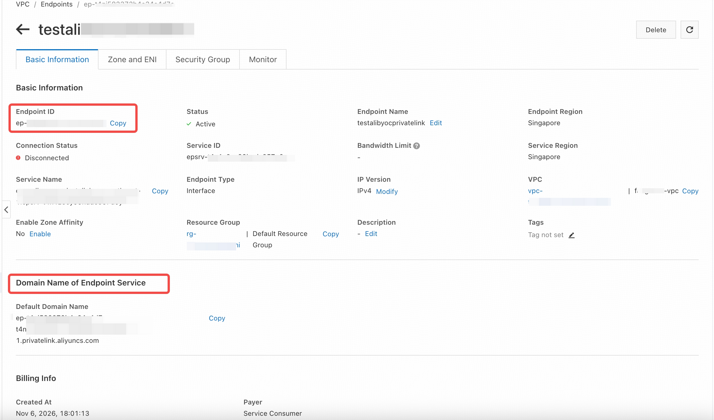

# Connect to {{{ .premium }}} via Alibaba Cloud Private Endpoint

This document describes how to connect to your {{{ .premium }}} instance via a private endpoint on Alibaba Cloud. Connecting through a private endpoint enables secure and private communication between your services and your {{{ .premium }}} instance without using the public internet.

> **Tip:**
>
> To learn how to connect to a {{{ .premium }}} instance via AWS PrivateLink, see [Connect to {{{ .premium }}} via AWS PrivateLink](/tidb-cloud/premium/connect-to-premium-via-aws-private-endpoint.md).

## Restrictions

- Currently, TiDB Premium supports private endpoint connections when the endpoint service is hosted on AWS or Alibaba Cloud. If the service is hosted on another cloud provider, the private endpoint is not applicable.
- Cross-region private endpoint connections are not supported.

## Set up a private endpoint with Alibaba Cloud

To connect to your Premium instance via a private endpoint, perform the following steps.

### Step 1. Choose a {{{ .premium }}} instance

1. On the [**My TiDB**](https://tidbcloud.com/tidbs) page, click the name of your target {{{ .premium }}} instance to go to its overview page.
2. Click **Connect** in the upper-right corner. A connection dialog is displayed.
3. In the **Connection Type** drop-down list, select **Private Endpoint**.
4. Take a note of **Service Name**, **Availability Zone ID**, and **Region ID**.

### Step 2. Create a private endpoint on Alibaba Cloud

To use the Alibaba Cloud Management Console to create a VPC interface endpoint, perform the following steps:

1. Sign in to the [Alibaba Cloud Management Console](https://account.alibabacloud.com/login/login.htm).
2. Navigate to **VPC** > **Endpoints**.
3. Click the **Interface Endpoints** tab, and then click **Create Endpoint**.
4. Fill in the endpoint details:
    - **Region**: select the same region as your {{{ .premium }}} instance.
    - **Endpoint Name**: enter a name for the endpoint.
    - **Endpoint Type**: choose **Interface Endpoint**.
    - **Endpoint Service**: select **Other Endpoint Services**.
5. In the **Endpoint Service Name** field, paste the service name you copied from TiDB Cloud.
6. Click **Verify**. A green check mark indicates that the service is valid.
7. Configure the network settings:
    - **VPC**: select the VPC where your application is deployed.
    - **Zone and vSwitch**: select at least two different zones from the **Availability Zone ID** values provided by TiDB Cloud in Step 1. For each selected zone, choose a vSwitch in that zone and in the selected VPC.
    - **Security Group**: select a security group that allows inbound TCP traffic from your application to the TiDB connection port, which is `4000` by default.
8. Click **OK** to create the endpoint.
9. Wait until the endpoint status becomes **Active**. The connection status might remain **Disconnected** until you complete Step 3. Proceed to Step 3 without waiting for **Connected**.

After creating the interface endpoint, navigate to the **EndPoints** page and select the newly created endpoint.

- In the **Basic Information** section, copy the **Endpoint ID**. You will use this value later as the *Endpoint Resource ID*.

- In the **Domain name of Endpoint Service** section, copy the **Default Domain Name**. You will use this value later as the *Domain Name*.

    

### Step 3. Accept the endpoint and create the endpoint connection

1. Return to the **Create Alibaba Cloud Private Endpoint Connection** dialog in the TiDB Cloud console.

2. Enter the **Endpoint ID** from Alibaba Cloud in **Private Endpoint Resource ID**, and the **Default Domain Name** in **Private Endpoint Default Domain Name**.

3. Click **Create** to submit the private endpoint connection request.

### Step 4. Connect to your {{{ .premium }}} instance

After you have accepted the endpoint connection, you are redirected back to the connection dialog.

1. Wait for the private endpoint connection status to become **Active** (approximately 5 minutes). To check the status, navigate to the **Networking** page by clicking **Settings** > **Networking** in the left navigation pane.

    Return to the Alibaba Cloud console, refresh the endpoint details page, and verify that **Connection Status** becomes **Connected**.

2. In the **Connect With** drop-down list, select your preferred connection method. The corresponding connection string is displayed at the bottom of the dialog.

3. Connect to your instance using the connection string.

## Private endpoint status reference

To view the statuses of private endpoints or private endpoint services, navigate to the **Networking** page by clicking **Settings** > **Networking** in the left navigation pane.

The possible statuses of a private endpoint are explained as follows:

- **Pending**: waiting for processing.
- **Active**: the private endpoint is ready for use.
- **Deleting**: the private endpoint is being deleted.
- **Failed**: the private endpoint creation fails. You can delete the private endpoint and create a new one.

The possible statuses of a private endpoint service are explained as follows:

- **Creating**: the endpoint service is being created, which takes 3 to 5 minutes.
- **Active**: the endpoint service is created, no matter whether the private endpoint is created or not.
