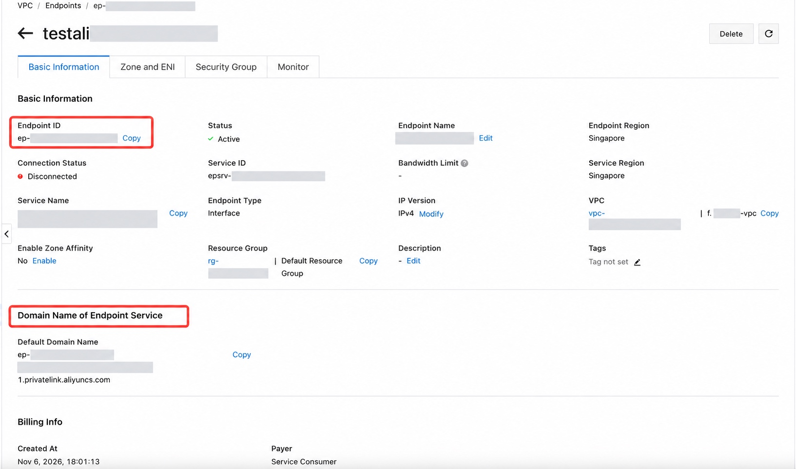

# 通过 Alibaba Cloud Private Endpoint 连接到 {{{ .premium }}}

本文档介绍如何通过 Alibaba Cloud 上的私有端点连接到你的 {{{ .premium }}} 实例。通过私有端点进行连接，无需使用公共互联网，即可在你的服务与 {{{ .premium }}} 实例之间实现安全且私密的通信。

> **Tip:**
>
> 如需了解如何通过 AWS PrivateLink 连接到 {{{ .premium }}} 实例，请参见 [通过 AWS PrivateLink 连接到 {{{ .premium }}}](/tidb-cloud/premium/connect-to-premium-via-aws-private-endpoint.md)。

## 限制 {#restrictions}

- 目前，TiDB Premium 支持在端点服务托管于 AWS 或 Alibaba Cloud 时使用私有端点连接。如果服务托管于其他云服务提供商，则不适用私有端点。
- 不支持跨 Region 的私有端点连接。

## 使用 Alibaba Cloud 设置私有端点 {#set-up-a-private-endpoint-with-alibaba-cloud}

要通过私有端点连接到你的 Premium 实例，请执行以下步骤。

### 步骤 1. 选择一个 {{{ .premium }}} 实例 {#step-1-choose-a-premium-instance}

1. 在 [**My TiDB**](https://tidbcloud.com/tidbs) 页面上，点击目标 {{{ .premium }}} 实例的名称，进入其概览页面。
2. 点击右上角的 **Connect**。此时会显示连接对话框。
3. 在 **Connection Type** 下拉列表中，选择 **Private Endpoint**。
4. 记下 **Service Name**、**Availability Zone ID** 和 **Region ID**。

### 步骤 2. 在 Alibaba Cloud 上创建私有端点 {#step-2-create-a-private-endpoint-on-alibaba-cloud}

要使用 Alibaba Cloud Management Console 创建 VPC 接口端点，请执行以下步骤：

1. 登录 [Alibaba Cloud Management Console](https://account.alibabacloud.com/login/login.htm)。
2. 导航到 **VPC** > **Endpoints**。
3. 点击 **Interface Endpoints** 页签，然后点击 **Create Endpoint**。
4. 填写端点详细信息：
    - **Region**：选择与你的 {{{ .premium }}} 实例相同的 Region。
    - **Endpoint Name**：输入端点名称。
    - **Endpoint Type**：选择 **Interface Endpoint**。
    - **Endpoint Service**：选择 **Other Endpoint Services**。
5. 在 **Endpoint Service Name** 字段中，粘贴你从 TiDB Cloud 复制的服务名称。
6. 点击 **Verify**。出现绿色对勾表示该服务有效。
7. 配置网络设置：
    - **VPC**：选择部署应用程序的 VPC。
    - **Zone and vSwitch**：从 TiDB Cloud 在步骤 1 中提供的 **Availability Zone ID** 值中，至少选择两个不同的可用区。对于每个选定的可用区，选择该可用区中且位于所选 VPC 内的一个 vSwitch。
    - **Security Group**：选择一个安全组，该安全组允许从你的应用程序到 TiDB 连接端口的入站 TCP 流量，默认端口为 `4000`。
8. 点击 **OK** 创建端点。
9. 等待端点状态变为 **Active**。在你完成步骤 3 之前，连接状态可能会保持为 **Disconnected**。无需等待 **Connected**，直接继续执行步骤 3。

创建接口端点后，导航到 **Endpoints** 页面并选择新创建的端点。

- 在 **Basic Information** 部分，复制 **Endpoint ID**。你稍后将使用该值作为 *Endpoint Resource ID*。

- 在 **Domain Name of Endpoint Service** 部分，复制 **Default Domain Name**。你稍后将使用该值作为 *Domain Name*。

    

### 步骤 3. 接受端点并创建端点连接 {#step-3-accept-the-endpoint-and-create-the-endpoint-connection}

1. 返回 TiDB Cloud 控制台中的 **Create Alibaba Cloud Private Endpoint Connection** 对话框。

2. 在 **Private Endpoint Resource ID** 中输入来自 Alibaba Cloud 的 **Endpoint ID**，并在 **Private Endpoint Default Domain Name** 中输入 **Default Domain Name**。

3. 点击 **Create** 提交私有端点连接请求。

### 步骤 4. 连接到你的 {{{ .premium }}} 实例 {#step-4-connect-to-your-premium-instance}

接受端点连接后，你将被重定向回连接对话框。

1. 等待私有端点连接状态变为 **Active**（大约 5 分钟）。要检查状态，请在左侧导航栏中点击 **Settings** > **Networking**，进入 **Networking** 页面。

    返回 Alibaba Cloud 控制台，刷新端点详细信息页面，并确认 **Connection Status** 变为 **Connected**。

2. 在 **Connect With** 下拉列表中，选择你偏好的连接方式。对应的连接字符串会显示在对话框底部。

3. 使用该连接字符串连接到你的实例。

## 私有端点状态参考 {#private-endpoint-status-reference}

要查看私有端点或私有端点服务的状态，请在左侧导航栏中点击 **Settings** > **Networking**，进入 **Networking** 页面。

私有端点的可能状态说明如下：

- **Pending**：等待处理。
- **Active**：私有端点已可供使用。
- **Deleting**：私有端点正在删除中。
- **Failed**：私有端点创建失败。你可以删除该私有端点并创建一个新的。

私有端点服务的可能状态说明如下：

- **Creating**：端点服务正在创建中，耗时 3 到 5 分钟。
- **Active**：端点服务已创建，无论私有端点是否已创建。