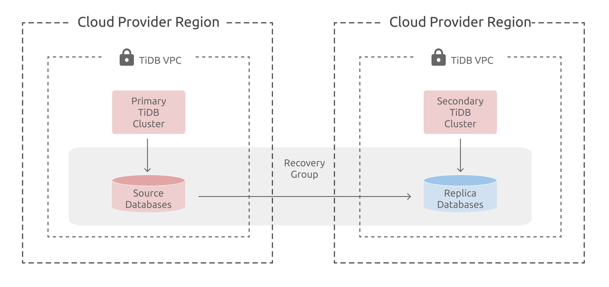

# リカバリグループの概要（PREVIEW） {#recovery-group-overview-preview}

TiDB Cloudリカバリグループを使用すると、 TiDB Cloud Dedicated クラスター間でデータベースを複製し、地域的な災害から保護できます。クラスター間でデータベースのフェイルオーバーをオーケストレーションできます。セカンダリクラスターへのフェイルオーバー後、元のプライマリクラスターが再び利用可能になった場合は、逆方向のレプリケーションを再確立してデータベースを再び保護できます。

## アーキテクチャ {#architecture}

リカバリグループは、2つのTiDB Cloud Dedicatedクラスター間でまとめてフェイルオーバーできる、複製されたデータベースのセットで構成されます。各リカバリグループにはプライマリクラスターが割り当てられ、このプライマリクラスター上のデータベースはグループに関連付けられ、セカンダリクラスターに複製されます。

- リカバリグループ: 2つのクラスター間で複製されるデータベースのグループ
- プライマリクラスター: アプリケーションによってデータベースがアクティブに書き込まれるクラスター
- セカンダリクラスター: データベースのレプリカが配置されているクラスター

> **Note**
>
> レプリカデータベースへのクライアント接続は、リカバリグループ機能によって明示的に読み取り専用に強制されることはありません。レプリカデータベースに接続するアプリケーションが読み取り専用クエリのみを実行するようにするのは、アプリケーションの責任です。

## 主な機能と制限 {#key-features-and-limitations}

- 現在、AWS でホストされているTiDB Cloud Dedicated クラスターのみがリカバリグループをサポートしています。
- リカバリグループは 2つのクラスター間に確立されます。
- リカバリグループでは、データベースの双方向レプリケーションはサポートされません。

> **Warning**
>
> この機能はパブリックプレビューであり、本番環境には推奨されません。

## 次は何？ {#what-s-next}

- リカバリグループの使用を開始するには、 [データベースリカバリグループの作成](/tidb-cloud/recovery-group-get-started.md)を参照してください。
- リカバリグループの使用方法については、 [データベースのフェイルオーバーと再保護](/tidb-cloud/recovery-group-failover.md)を参照してください。
