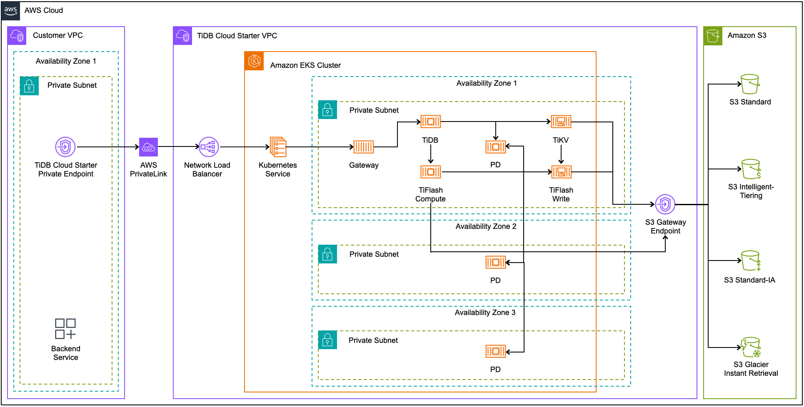

# TiDB Cloud 中的高可用

TiDB Cloud 通过强大的机制，默认保持高可用和数据持久性，防止单点故障，并确保即使在发生中断时也能持续提供 service。作为基于经过实战检验的 TiDB 开源产品的全托管 service，TiDB Cloud 继承了 TiDB 的核心高可用（HA）特性，并结合了额外的云原生能力。

> **注意：**
>
> - 本文档仅适用于 {{{ .starter }}}、{{{ .essential }}} 和 {{{ .premium }}}。
> - 关于 TiDB Cloud Dedicated 的高可用，请参见 [TiDB Cloud Dedicated 的高可用](/tidb-cloud/high-availability-with-multi-az.md)。

## 概述

TiDB 通过 Raft 一致性算法确保高可用和数据持久性。该算法会持续地在多个 node 之间复制数据修改，使 TiDB 即使在 node 故障或网络分区时也能处理读写 request。这种方式同时提供了高数据持久性和容错能力。

TiDB Cloud 在此基础上扩展了分区高可用和区域高可用能力，以满足不同的运维需求。

> **Note:**
>
> - 对于 {{{ .starter }}} 实例，仅启用分区高可用，且不可配置。
> - 对于 {{{ .premium }}} 实例，仅启用区域高可用，且不可配置。
> - 对于托管在 AWS `Tokyo (ap-northeast-1)` Region 的 {{{ .essential }}} 实例，默认启用区域高可用。你可以在创建 {{{ .essential }}} 实例时根据需要将其更改为分区高可用。对于托管在其他 Region 的 {{{ .essential }}} 实例，仅启用分区高可用，且不可配置。

- **分区高可用**：该选项将所有 node 部署在同一个可用区内，降低网络延时。它无需在应用层实现跨区冗余即可保证高可用，适用于优先考虑单区低延时的应用。详细信息参见 [分区高可用架构](#zonal-high-availability-architecture)。

- **区域高可用（PREVIEW）**：该选项将 node 分布在多个可用区，实现最大程度的基础设施隔离和冗余。它提供最高级别的可用性，但需要应用层实现跨区冗余。如果你需要最大程度防护单区基础设施故障，建议选择该选项。需要注意的是，该模式会增加延时，并可能产生跨区数据传输费用。该功能仅在拥有三个以上可用区的 Region 可用。详细信息参见 [区域高可用架构](#regional-high-availability-architecture)。

## 分区高可用架构

当你创建启用分区高可用的 {{{ .starter }}} 或 Essential 实例时，所有组件（包括 Gateway、TiDB、TiKV 和 TiFlash 计算/写 node）都运行在同一个可用区内。数据面组件的部署通过虚拟机池提供基础设施冗余，从而最大程度减少故障转移时间和因同区部署带来的网络延时。

<CustomContent language="en,zh">

- 下图展示了 AWS 上分区高可用的架构：

    

- 下图展示了阿里云上分区高可用的架构：

    

</CustomContent>

<CustomContent language="ja">

下图展示了 AWS 上分区高可用的架构：

</CustomContent>

在分区高可用架构下：

- Placement Driver（PD）跨多个可用区部署，通过跨区冗余复制数据以确保高可用。
- 数据在本地可用区内的 TiKV server 和 TiFlash 写 node 之间复制。
- TiDB server 和 TiFlash 计算 node 负责从 TiKV 和 TiFlash 写 node 读写数据，这些 node 通过存储层复制机制保障数据安全。

### 故障转移流程

TiDB Cloud 会在节点故障后自动执行以下恢复步骤。

<CustomContent language="en,zh">

- 会创建一个新的副本来替换故障副本。

- 提供存储 service 的 server 会从 Amazon S3 或阿里云 OSS（取决于你的云服务商）持久化的数据中恢复本地 cache，将系统恢复到与副本一致的状态。

在存储层，持久化数据会定期 push 到 Amazon S3 或阿里云 OSS（取决于你的云服务商），以实现高持久性。此外，最新的 update 不仅会在多个 TiKV server 之间复制，还会存储在每台 server 的 EBS 上，EBS 也会进一步复制数据以增强持久性。TiDB 会自动对可恢复的操作进行退避重试。

</CustomContent>

<CustomContent language="ja">

- 会创建一个新的副本来替换故障副本。

- 提供存储 service 的 server 会从 Amazon S3（取决于你的云服务商）持久化的数据中恢复本地 cache，将系统恢复到与副本一致的状态。

在存储层，持久化数据会定期 push 到 Amazon S3，以实现高持久性。此外，最新的 update 不仅会在多个 TiKV server 之间复制，还会存储在每台 server 的 EBS 上，EBS 也会进一步复制数据以增强持久性。TiDB 会自动对可恢复的操作进行退避重试。

</CustomContent>

Gateway 和计算层为无状态的，可以通过重启来恢复数据库服务。应用应在发生可恢复的连接故障后重新连接，并仅重试可安全重复的请求，遵循[重试指南](#impact-on-sessions-during-failures)。分区高可用虽然能提供高可用，但无法应对整个可用区的故障。如果可用区不可用，将会发生停机，直到该区及其依赖的 service 恢复。

## 区域高可用架构

当你创建启用区域高可用的 {{{ .essential }}} 或 {{{ .premium }}} 实例时，关键 OLTP（联机事务处理）工作负载组件（如 PD 和 TiKV）会跨多个可用区部署，以确保冗余复制并最大化可用性。在正常运行期间，Gateway、TiDB 和 TiFlash 计算/写 node 等组件会部署在主可用区。这些数据面组件通过虚拟机池提供基础设施冗余，从而最大程度减少故障转移时间和因同区部署带来的网络延时。

> **注意：**
>
> 区域高可用目前处于公开预览阶段。

<CustomContent language="en,zh">

- 下图展示了 AWS 上区域高可用的架构：

    

- 下图展示了阿里云上区域高可用的架构：

    

</CustomContent>

<CustomContent language="ja">

下图展示了 AWS 上区域高可用的架构：

</CustomContent>

在区域高可用架构下：

- Placement Driver（PD）和 TiKV 跨多个可用区部署，数据始终在各区冗余复制，以确保最高级别的可用性。
- 数据在主可用区内的 TiFlash 写 node 之间复制。
- TiDB server 和 TiFlash 计算 node 负责从这些 TiKV 和 TiFlash 写 node 读写数据，这些 node 通过存储层复制机制保障数据安全。

### 故障转移流程

在极少数情况下，主可用区发生故障（如自然灾害、配置变更、软件问题或硬件故障），关键 OLTP 工作负载组件（包括 Gateway 和 TiDB）会自动在备用可用区启动。流量会自动重定向到备用区，以确保快速恢复并保持业务可持续性。

TiDB Cloud 通过以下措施，最大程度减少主可用区故障期间的 service 中断并保障业务可持续性：

- 在备用可用区自动创建 Gateway 和 TiDB 的新副本。
- 通过弹性负载均衡器检测备用可用区的活跃 Gateway 副本，并将 OLTP 流量从故障主区重定向到备用区。

除了通过 TiKV 复制提供高可用外，TiKV 实例还会部署并配置为将每个数据副本放置在不同的可用区。只要有两个可用区正常运行，系统就能保持可用。为实现高持久性，数据会定期备份到 S3。即使两个可用区同时故障，存储在 S3 上的数据依然可访问和恢复。

在可用区发生故障期间，连接或请求可能会中断，吞吐可能会暂时下降。如果主可用区发生故障，Gateway 和 TiDB 会在备用可用区启动以处理工作负载。应用应重新连接到活跃 server，并遵循[重试指南](#impact-on-sessions-during-failures)。

## 自动备份与持久性

数据库备份对于业务可持续性和容灾至关重要，有助于防止数据损坏或误删。通过备份，你可以在保留时间内将数据库恢复到指定时间点，最大程度减少数据丢失和停机时间。

TiDB Cloud 提供了强大的自动备份机制，确保持续的数据保护：

- **每日全量备份**：每天会创建一次数据库的全量备份，捕获整个数据库的状态。
- **持续事务日志备份**：事务日志会持续备份，大约每 5 分钟一次，具体频率取决于数据库活动量。

这些自动备份使你可以通过全量备份或结合全量备份与持续事务日志，将数据库恢复到任意指定时间点。这种灵活性确保你可以将数据库恢复到事故发生前的精确时刻。

<CustomContent language="en,zh">

> **注意：**
>
> 自动备份（包括基于快照的备份和用于时间点恢复（PITR）的持续备份）会在 Amazon S3 或阿里云 OSS（取决于你的云服务商）上执行，具备区域级别的高持久性。

</CustomContent>

<CustomContent language="ja">

> **注意：**
>
> 自动备份（包括基于快照的备份和用于时间点恢复（PITR）的持续备份）会在 Amazon S3 上执行，具备区域级别的高持久性。

</CustomContent>

## 故障期间对会话的影响

在故障发生时，正在故障 server 上运行的事务可能会被中断。应用必须处理活跃事务期间可恢复的故障。不同故障场景的处理方式如下：

- **TiDB 故障**：如果 TiDB node 故障，并且该实例有另一个可用的 TiDB 计算副本，TiDB Cloud 会通过 Gateway 重路由流量。故障节点上的事务可能会被中断，新事务会由可用副本处理。如果该实例仅由单个 TiDB 计算副本提供服务，则该副本发生故障会导致数据库服务在恢复期间不可用。在这两种情况下，已成功提交的数据都会被保留。
- **Gateway 故障**：如果 Gateway 故障，client 连接会被中断。TiDB Cloud 的 Gateway 为无状态的，可以在另一台 server 上重启。流量会自动重定向到健康的 Gateway。

在发生可恢复的连接故障后重新连接，并且仅重试可安全重复的请求。对于提交结果未知的写入，请使用应用级幂等性来防止重复影响，或在重试前验证写入未提交。有关连接处理的更多信息，请参阅你的驱动或 ORM 文档（例如 [JDBC](https://dev.mysql.com/doc/connector-j/en/connector-j-config-failover.html)）。

## RTO 和 RPO

- **恢复时间目标 (RTO)** 是发生故障后数据库服务完全不可用的最长可接受持续时间。RTO 为 0 表示数据库服务保持可用，尽管单个连接或请求仍可能需要重试。
- **恢复点目标 (RPO)** 是数据丢失的最长可接受时间窗口。RPO 为 0 表示所有成功提交的数据都会被保留。

分区高可用恢复目标适用于单节点故障。区域高可用恢复目标适用于单个可用区故障。

| 高可用架构 | RTO (秒) | RPO (秒) |
|--------------------------------|---------------|---------------|
| 分区高可用        | ≤ 600         | 0             |
| 区域高可用     | 0             | 0             |

对于分区高可用，当多个 TiDB 计算副本中的一个发生故障时，数据库服务仍保持可用；而唯一副本发生故障时，可能会导致最长 600 秒的停机，直到替代副本准备就绪。

即使 RTO 为 0，恢复期间吞吐也可能暂时下降。对于中断的请求，请遵循[安全重试指南](#impact-on-sessions-during-failures)，尤其是提交结果未知的写入。
