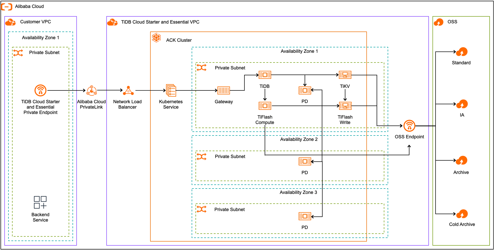
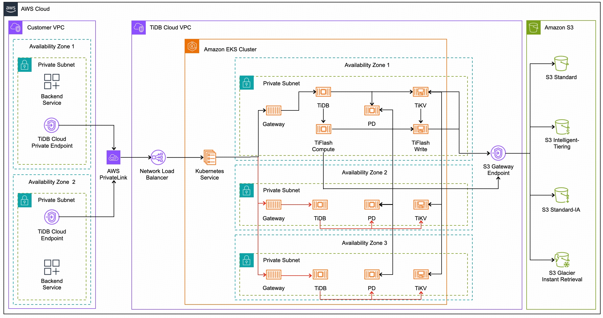
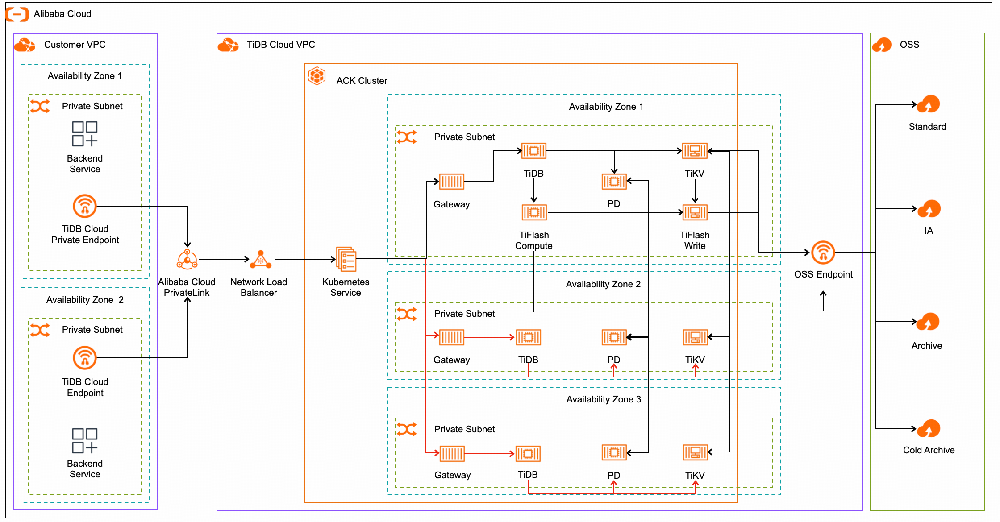

# High Availability in TiDB Cloud

TiDB Cloud is designed with robust mechanisms to maintain high availability and data durability by default, preventing single points of failure and ensuring continuous service even in the face of disruptions. As a fully managed service based on the battle-tested TiDB Open Source product, it inherits TiDB's core high availability (HA) features and augments them with additional cloud-native capabilities.

> **Note:**
>
> - This document is only applicable for {{{ .starter }}}, {{{ .essential }}}, and {{{ .premium }}}.
> - For high availability in TiDB Cloud Dedicated, see [High Availability in TiDB Cloud Dedicated](/tidb-cloud/high-availability-with-multi-az.md).

## Overview

TiDB ensures high availability and data durability using the Raft consensus algorithm. This algorithm consistently replicates data changes across multiple nodes, allowing TiDB to handle read and write requests even in the event of node failures or network partitions. This approach provides both high data durability and fault tolerance.

TiDB Cloud extends these capabilities with zonal high availability and regional high availability to meet different operational requirements.

> **Note:**
>
> - For {{{ .starter }}} instances, only zonal high availability is enabled, and it is not configurable.
> - For {{{ .premium }}} instances, only regional high availability is enabled and is not configurable.
> - For {{{ .essential }}} instances hosted in the AWS `Tokyo (ap-northeast-1)` region, regional high availability is enabled by default. You can change it to zonal high availability as needed during {{{ .essential }}} instance creation. For {{{ .essential }}} instances hosted in other regions, only zonal high availability is enabled, and it is not configurable.

- **Zonal high availability**: This option places all nodes within a single availability zone, reducing network latency. It ensures high availability without requiring application-level redundancy across zones, making it suitable for applications that prioritize low latency within a single zone. For more information, see [Zonal high availability architecture](#zonal-high-availability-architecture).

- **Regional high availability (PREVIEW)**: This option distributes nodes across multiple availability zones, offering maximum infrastructure isolation and redundancy. It provides the highest level of availability but requires application-level redundancy across zones. It is recommended to choose this option if you need maximum availability protection against infrastructure failures within a zone. Note that it increases latency and might incur cross-zone data transfer fees. This feature is available in regions with more than three availability zones. For more information, see [Regional high availability architecture](#regional-high-availability-architecture).

## Zonal high availability architecture

When you create a {{{ .starter }}} or Essential instance with the zonal high availability, all components, including Gateway, TiDB, TiKV, and TiFlash compute/write nodes, run in the same availability zone. The placement of these components in the data plane offer infrastructure redundancy with virtual machine pools, which minimizes failover time and network latency due to colocation.

<CustomContent language="en,zh">

- The following diagram shows the architecture of zonal high availability on AWS:

    

- The following diagram shows the architecture of zonal high availability on Alibaba Cloud:

    

</CustomContent>

<CustomContent language="ja">

The following diagram shows the architecture of zonal high availability on AWS:

</CustomContent>

In zonal high availability architecture:

- The Placement Driver (PD) is deployed across multiple availability zones, ensuring high availability by replicating data redundantly across zones.
- Data is replicated across TiKV servers and TiFlash write nodes within the local availability zone.
- TiDB servers and TiFlash compute nodes read from and write to TiKV and TiFlash write nodes, which are safeguarded by storage-level replication.

### Failover process

TiDB Cloud automatically performs the following recovery steps after a node failure.

<CustomContent language="en,zh">

- A new replica is created to replace the failed one.

- Servers providing storage services recover local caches from persisted data on Amazon S3 or Alibaba Cloud OSS (depending on your cloud provider), restoring the system to a consistent state with the replicas.

In the storage layer, persisted data is regularly pushed to Amazon S3 or Alibaba Cloud OSS (depending on your cloud provider) for high durability. Moreover, immediate updates are not only replicated across multiple TiKV servers but also stored on the EBS of each server, which further replicates the data for additional durability. TiDB automatically retries recoverable operations with backoff.

</CustomContent>

<CustomContent language="ja">

- A new replica is created to replace the failed one.

- Servers providing storage services recover local caches from persisted data on Amazon S3 (depending on your cloud provider), restoring the system to a consistent state with the replicas.

In the storage layer, persisted data is regularly pushed to Amazon S3 for high durability. Moreover, immediate updates are not only replicated across multiple TiKV servers but also stored on the EBS of each server, which further replicates the data for additional durability. TiDB automatically retries recoverable operations with backoff.

</CustomContent>

The gateway and computing layers are stateless and can be restarted to restore database service. Applications should reconnect after recoverable connection failures and retry only requests that are safe to repeat, following the [retry guidance](#impact-on-sessions-during-failures). While the zonal setup provides high availability, it cannot handle an entire zone failure. If the zone becomes unavailable, downtime will occur until the zone and its dependent services are restored.

## Regional high availability architecture

When you create a {{{ .essential }}} or {{{ .premium }}} instance with regional high availability, critical OLTP (Online Transactional Processing) workload components, such as PD and TiKV, are deployed across multiple availability zones to ensure redundant replication and maximize availability. During normal operations, components like Gateway, TiDB, and TiFlash compute/write nodes are hosted in the primary availability zone. These components in data plane offer infrastructure redundancy through virtual machine pools, which minimizes failover time and network latency due to colocation.

> **Note:**
>
> Regional high availability is currently in public preview.

<CustomContent language="en,zh">

- The following diagram shows the architecture of regional high availability on AWS:

    

- The following diagram shows the architecture of regional high availability on Alibaba Cloud:

    

</CustomContent>

<CustomContent language="ja">

The following diagram shows the architecture of regional high availability on AWS:

</CustomContent>

In regional high availability architecture:

- The Placement Driver (PD) and TiKV are deployed across multiple availability zones, and data is always replicated redundantly across zones to ensure the highest level of availability.
- Data is replicated across TiFlash write nodes within the primary availability zone.
- TiDB servers and TiFlash compute nodes read from and write to these TiKV and TiFlash write nodes, which are safeguarded by storage-level replication.

### Failover process

In the rare event of a primary zone failure scenario, which could be caused by a natural disaster, configuration change, software issue, or hardware failure, critical OLTP workload components, including Gateway and TiDB, are automatically launched in the standby availability zone. Traffic is automatically redirected to the standby zone to ensure swift recovery and maintain business continuity.

TiDB Cloud minimizes service disruption and ensures business continuity during a primary zone failure by performing the following actions:

- Automatically create new replicas of Gateway and TiDB in the standby availability zone.
- Use the elastic load balancer to detect active gateway replicas in the standby availability zone and redirect OLTP traffic from the failed primary zone.

In addition to providing high availability through TiKV replication, TiKV instances are deployed and configured to place each data replica in a different availability zone. The system remains available as long as two availability zones are operating normally. For high durability, data persistence is ensured by regularly backing up data to S3. Even if two zones fail, data stored in S3 remains accessible and recoverable.

During an availability-zone failure, connections or requests might be interrupted, and throughput might temporarily decrease. If the primary zone fails, Gateway and TiDB are launched in the standby availability zone to handle workloads. Applications should reconnect to active servers and follow the [retry guidance](#impact-on-sessions-during-failures).

## Automatic backups and durability

Database backups are essential for business continuity and disaster recovery, helping to protect your data from corruption or accidental deletion. With backups, you can restore your database to a specific point in time within the retention period, minimizing data loss and downtime.

TiDB Cloud provides robust automated backup mechanisms to ensure continuous data protection:

- **Daily full backups**: A full backup of your database is created once a day, capturing the entire database state.
- **Continuous transaction log backups**: Transaction logs are backed up continuously, approximately every 5 minutes, though the exact frequency depends on database activity.

These automated backups enable you to restore your database either from a full backup or from a specific point in time by combining full backups with continuous transaction logs. This flexibility ensures that you can recover your database to a precise point just before an incident occurs.

<CustomContent language="en,zh">

> **Note:**
>
> Automatic backups, including snapshot-based and continuous backups for Point-in-Time Recovery (PITR), are performed on Amazon S3 or Alibaba Cloud OSS (depending on your cloud provider), which provides regional-level high durability.

</CustomContent>

<CustomContent language="ja">

> **Note:**
>
> Automatic backups, including snapshot-based and continuous backups for Point-in-Time Recovery (PITR), are performed on Amazon S3, which provides regional-level high durability.

</CustomContent>

## Impact on sessions during failures

During a failure, ongoing transactions on the failed server might be interrupted. Applications must handle recoverable failures during active transactions. Different failure scenarios are handled as follows:

- **TiDB failures**: If a TiDB node fails and another TiDB compute replica is available for the instance, TiDB Cloud reroutes traffic through the gateway. Transactions on the failed node might be interrupted, and new transactions are handled by the available replica. If the instance is served by a single TiDB compute replica, failure of that replica makes the database service unavailable during recovery. Successfully committed data is preserved in both cases.
- **Gateway failures**: If the Gateway fails, client connections are disrupted. TiDB Cloud gateways are stateless and can be restarted on another server. Traffic is automatically redirected to a healthy gateway.

Reconnect after recoverable connection failures and retry only requests that are safe to repeat. For writes with an unknown commit outcome, use application-level idempotency to prevent duplicate effects or verify that the write did not commit before retrying. For more information about connection handling, see your driver or ORM documentation (for example, [JDBC](https://dev.mysql.com/doc/connector-j/en/connector-j-config-failover.html)).

## RTO and RPO

- **Recovery Time Objective (RTO)** is the maximum acceptable duration of complete database service unavailability after a failure. An RTO of 0 means the database service remains available, although individual connections or requests might still require retries.
- **Recovery Point Objective (RPO)** is the maximum acceptable time window of data loss. An RPO of 0 means all successfully committed data is preserved.

Zonal HA recovery objectives apply to single-node failures. Regional HA recovery objectives apply to the failure of a single availability zone.

| High availability architecture | RTO (seconds) | RPO (seconds) |
|--------------------------------|---------------|---------------|
| Zonal high availability        | ≤ 600         | 0             |
| Regional high availability     | 0             | 0             |

For zonal HA, database service remains available when one of multiple TiDB compute replicas fails, while failure of the only replica can cause up to 600 seconds of downtime until a replacement is ready.

Throughput might temporarily decrease during recovery. Follow the [safe retry guidance](#impact-on-sessions-during-failures) for interrupted requests, especially writes with an unknown commit outcome.
